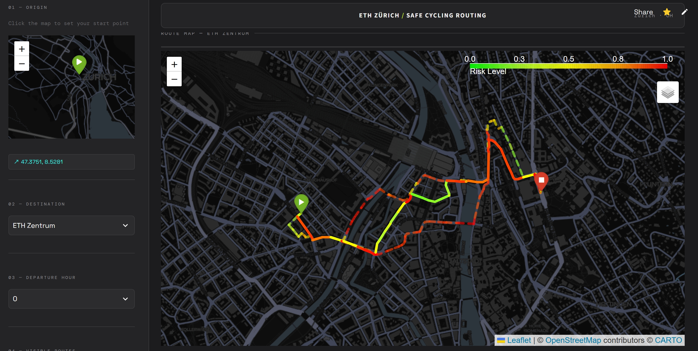
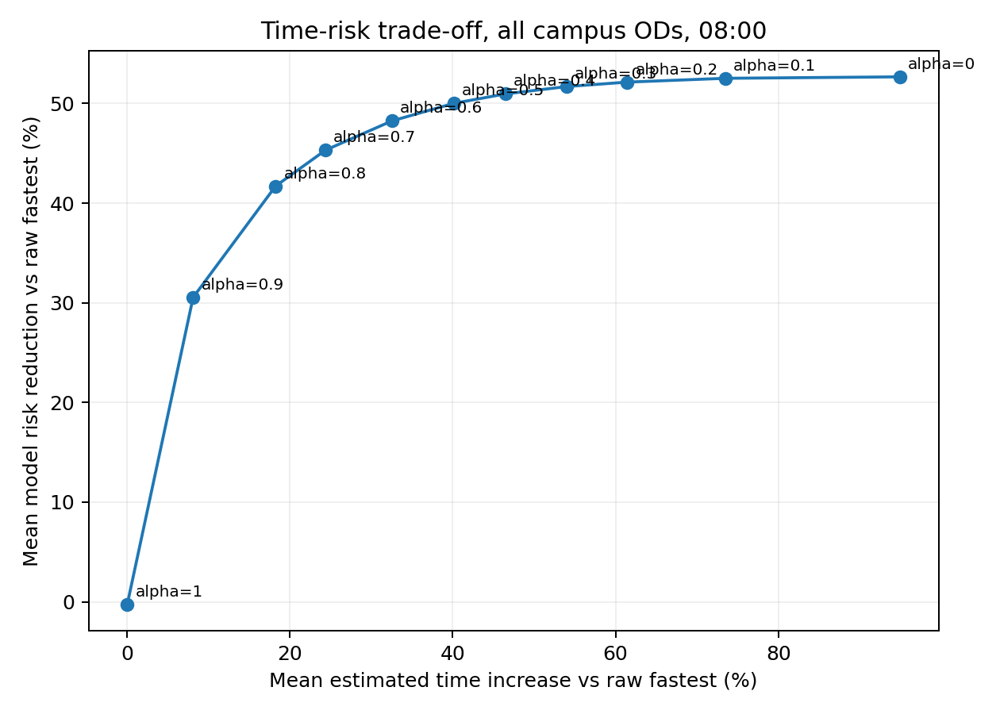

# Zurich Safe Cycling Route Recommender

A Python-based cycling route recommender for Zurich, developed for the *Computer Programming & Data Science* course at ETH Zurich (June 2026). It compares travel time, distance and modeled accident-risk exposure for trips to ETH Zentrum and ETH Hoenggerberg.

[**Live demo**](https://safety-cycling.streamlit.app/)

**Key result:** Across 27,598 OD pairs, balanced routing (alpha=0.8) reduces the modeled exposure index by **41.71%**, with **18.24%** more estimated travel time (**3.50 minutes**). 



## Overview

1. **Step 1 - Risk modelling:** Associate bicycle accidents with the OSM cycling network and estimate hourly risk using hierarchical Bayesian partial pooling.
2. **Step 2 - Routing:** Compute shortest, fastest, safest and balanced routes using NetworkX.
3. **Step 3 - Visualisation:** Display routes and comparison metrics in Streamlit with Folium and Plotly.

Core libraries: Pandas, NumPy, SciPy, GeoPandas, Shapely, OSMnx, NetworkX, Streamlit, Folium and Plotly.

## Installation

Python 3.10+ and Git LFS are required. Run commands from the repository root.

```bash
git clone https://github.com/Designhaoyu/SafeCyclingRouting.git
cd SafeCyclingRouting
git lfs install
git lfs pull
python -m venv .venv
```

Activate with `.venv\Scripts\Activate.ps1` in PowerShell or `source .venv/bin/activate` on macOS/Linux, then:

```bash
python -m pip install -r requirements.txt
streamlit run frontend.py
```

For the CARTO Dark Matter basemap, copy [the secrets template](.streamlit/secrets.toml.example) to `.streamlit/secrets.toml` and enter your key. On Streamlit Community Cloud, select `frontend.py` as the entry point and configure `CARTO_BASEMAP_API_KEY` in application Secrets. Without a key, maps use OpenStreetMap. Secrets and generated map HTML are excluded from Git; the browser can still see the tile-request key.

## Step 1 - Data & Risk Scores

The input contains 70,767 police-registered accidents from 2011-2025, including 8,753 valid bicycle-involving records. Accidents are associated with 50 m road buffers in EPSG:2056; identical reverse-direction geometries are consolidated for estimation. Each clock hour is fitted separately.

For segment i, road class g and hour h:

$$
y_{ih}\mid\lambda_{ih}\sim\mathrm{Poisson}(E_i\lambda_{ih}),\qquad
\lambda_{ih}\mid\mu_{gh}\sim\mathrm{Gamma}(2,2/\mu_{gh})
$$

$$
\log\mu_{gh}\mid\mu_{0h}\sim\mathcal N(\log\mu_{0h},1),\qquad
\log\mu_{0h}\sim\mathcal N(0,25).
$$

Gamma uses shape/rate; Normal uses mean/variance. Here y is the buffered accident count and E is segment length in km (minimum 0.01 km) times 15 years. Conditional on the group mean:

$$
\mathbb E[\lambda_{ih}\mid y_{ih},\mu_{gh}]
=\frac{y_{ih}+2}{E_i+2/\mu_{gh}}.
$$

Let m be this mean averaged over the group-mean posterior. The routing score is:

$$
r_{eh}=\mathrm{PercentileRank}_{e}\!\left(
3\frac{m_{eh}-\min_e m_{eh}}{\max_e m_{eh}-\min_e m_{eh}}+p_e
\right),\qquad s_{eh}=1-r_{eh}.
$$

The normalized term is zero if its range is zero. Posterior means are mapped back to directed edges before hourly ranking. The road-class penalty p includes cycleway=0, residential=0.15, tertiary=0.30, secondary=0.45 and primary=0.65. The full penalty table ranges from 0 to 1. The coefficient 3 matches `3 * normalized + penalty` in [the scoring code](scripts/update_bayesian_risk.py): it is a fixed heuristic that emphasizes normalized accident intensity relative to road class, not a fitted parameter or a demonstrated scale-matching choice. It has not been sensitivity-tested; the routing-weight sweep below does not calibrate this coefficient.

Output: `data/processed/zurich_hourly_edge_safety_score.csv`, with edge identity, hour, `risk_score` and `safety_score`. Lower risk scores indicate safer relative rankings. Posterior uncertainty describes accident intensity, not the percentile score or an individual crash probability.

[Model, priors and diagnostics](docs/hierarchical_bayesian_risk.md)

## Step 2 - Routing

For path P, risk exposure is $R(P)=\sum_{e\in P}r_{eh}L_e$. The four edge objectives are:

| Strategy | Edge cost |
|---|---|
| `shortest_distance` | Length L in metres |
| `fastest_time` | Estimated travel time t in seconds |
| `safest_route` | Risk exposure rL |
| `balanced_route` | $\alpha\widetilde t+(1-\alpha)\widetilde{rL}$ |

Tildes denote graph-wide edge min-max normalization. Alpha ranges from 0 to 1; increasing it prioritizes time. Distance is an evaluation metric, not a third balanced objective. Travel time uses road-class cycling speeds.

```bash
# Wiedikon to both campuses at 08:00
python scripts/run_step2_pipeline.py
```

For a custom query, add `--origin-lat`, `--origin-lon`, `--destination` and `--time-period`. Destinations are `eth_zentrum`, `eth_hoenggerberg` or `both_campuses`.

[Routing details](docs/step2_algorithm_explanation.md)

### Benchmark & Weight Sensitivity

At 08:00, evaluate 13,799 reachable intersection origins per campus: **27,598 OD pairs** and **110,392 routes** across four strategies. Origins have OSM `street_count >= 3`; destinations themselves and unreachable nodes are excluded. Every OD has equal weight. These are model-network pairs, not observed traffic flows or a separately boundary-clipped census of physical junctions.

```bash
python scripts/benchmark_all_campus_od.py
python scripts/weight_sensitivity.py
```

Sensitivity analysis sweeps alpha=0,0.1,...,1 over the same OD pairs. Based on the safety-efficiency trade-off, the selected default is **alpha=0.8**: 80% normalized time cost and 20% normalized risk cost. It is a selected operating point, not a unique overall optimum.

| Strategy | Mean risk exposure reduction | Mean time increase | Mean distance change | Mean extra time |
|---|---:|---:|---:|---:|
| Shortest | 19.66% | 7.34% | -3.54% | 1.42 min |
| Balanced (0.8 / 0.2) | 41.71% | 18.24% | +2.47% | 3.50 min |
| Safest | 52.67% | 94.85% | +52.72% | 19.01 min |

Changes are calculated per OD against the raw fastest route, then averaged. These are relative changes in a modeled exposure index. The score r is a percentile rank, so summing r times length does not estimate the number of accidents.

**Normalization limitation:** For any edge cost x and a path with n edges, the implemented min-max sum is

$$
\sum_{e\in P}\frac{x_e-x_{\min}}{x_{\max}-x_{\min}}
=\frac{\sum_{e\in P}x_e-nx_{\min}}{x_{\max}-x_{\min}}.
$$

When the minimum is positive, the subtraction rewards additional edges relative to simply scaling the total cost. Routes with more edges can therefore appear cheaper, making results sensitive to network segmentation. This affects both normalized components and can change path rankings, even at alpha=0 or 1. The reported results retain this implementation; removing this effect would require changing normalization and rerunning the analysis. Weight scanning does not enumerate the full Pareto front.

[Methods](docs/benchmark_and_sensitivity.md) | [Benchmark](results/benchmark_all_campus_od/report.md) | [Sensitivity](results/weight_sensitivity/report.md)



## Step 3 - Visualisation & Interaction

The Streamlit app supports map-based origin selection, campus and departure-hour selection, four route layers, and time/risk/distance comparisons. `frontend.py` calls `backend.py`; current-query GeoJSON, CSV, Markdown and plot outputs are written under `results/`. The local interactive map is `results/recommended_route_map.html`. Offline evaluation results are stored separately.

## Project Structure

```text
SafeCyclingRouting/
|-- frontend.py                     # Streamlit interface
|-- backend.py                      # Routing wrapper and map rendering
|-- src/zurich_safe_routing/         # Bayesian model, graph, routing and exports
|-- scripts/
|   |-- update_bayesian_risk.py
|   |-- run_step2_pipeline.py
|   |-- benchmark_all_campus_od.py
|   |-- weight_sensitivity.py
|-- data/{raw,processed}/
|-- results/{bayesian_risk,benchmark_all_campus_od,weight_sensitivity}/
|-- docs/
|   |-- hierarchical_bayesian_risk.md
|   |-- benchmark_and_sensitivity.md
|   |-- step2_algorithm_explanation.md
|-- requirements.txt
|-- LICENSE
|-- README.md
```

To reproduce everything, run the four scripts in the listed order. Bayesian fitting is optional when using the supplied score table. Rebuilding scores requires rerunning downstream analyses. Large reproducible posterior and route-level CSVs remain local; compact reports, diagnostics and figures are included in Git.

## Data Sources

- [Zurich accident data](https://data.stadt-zuerich.ch/dataset/sid_dav_strassenverkehrsunfallorte): **Creative Commons Attribution (CC BY)**, as listed on the dataset page (no version specified). Published through Open Data Zurich; data supplier: **Bundesamt für Strassen (ASTRA)**; data owner: **Dienstabteilung Verkehr, Sicherheitsdepartement, Stadt Zürich**. Required source attribution: **Bundesamt für Strassen ASTRA**.
- [OpenStreetMap](https://www.openstreetmap.org/copyright): cycling network, ODbL.

##  Limitations
- Length-years are an exposure proxy; cyclist traffic volumes are unavailable. Counts describe accident intensity, not per-trip crash risk.
- Historical reporting, network changes and road-class penalties also affect estimates.
- Sampling diagnostics check mixing, not predictive validity. Held-out temporal validation and uncertainty propagation into route selection have not been performed.

Future work includes traffic-volume adjustment, temporal validation, and comparison with external route planners.

## License

Project source code is available under the [MIT License](LICENSE). Accident data, OSM-derived data, map tiles and third-party dependencies retain their respective licences; MIT does not relicense those materials.
